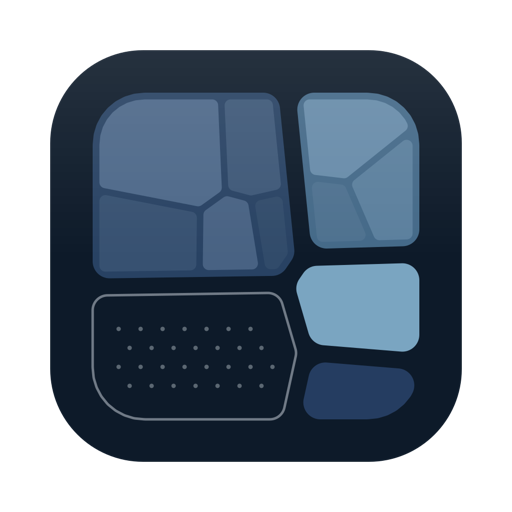
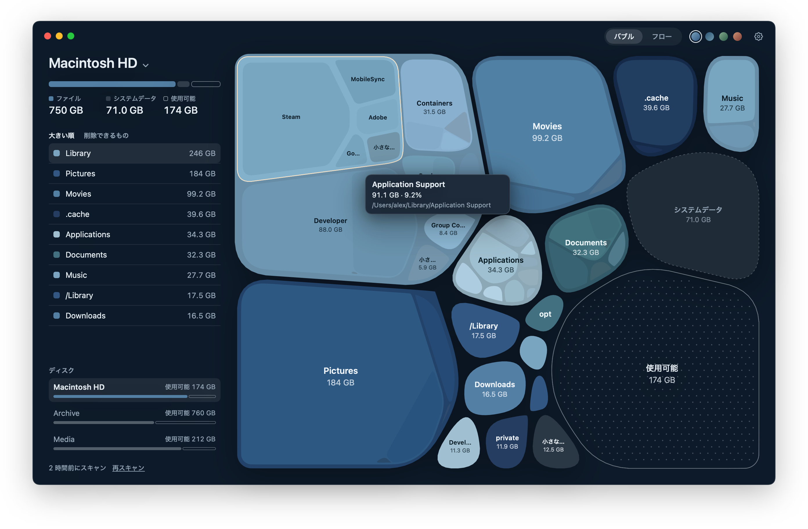
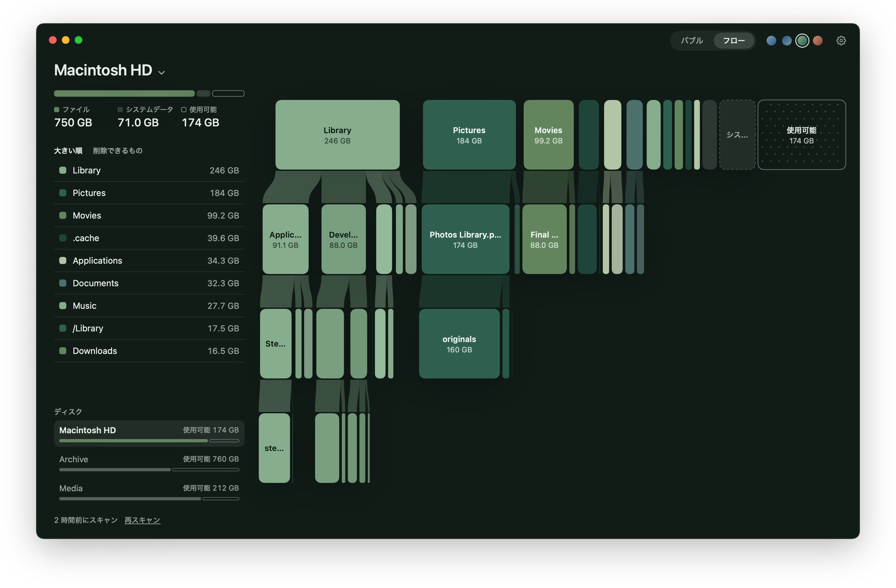
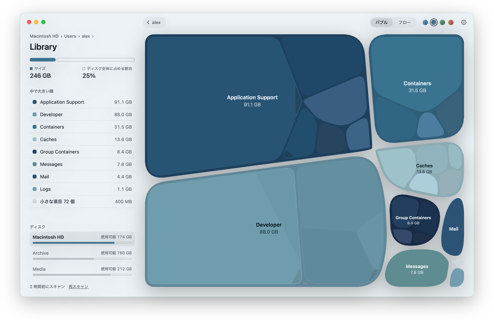
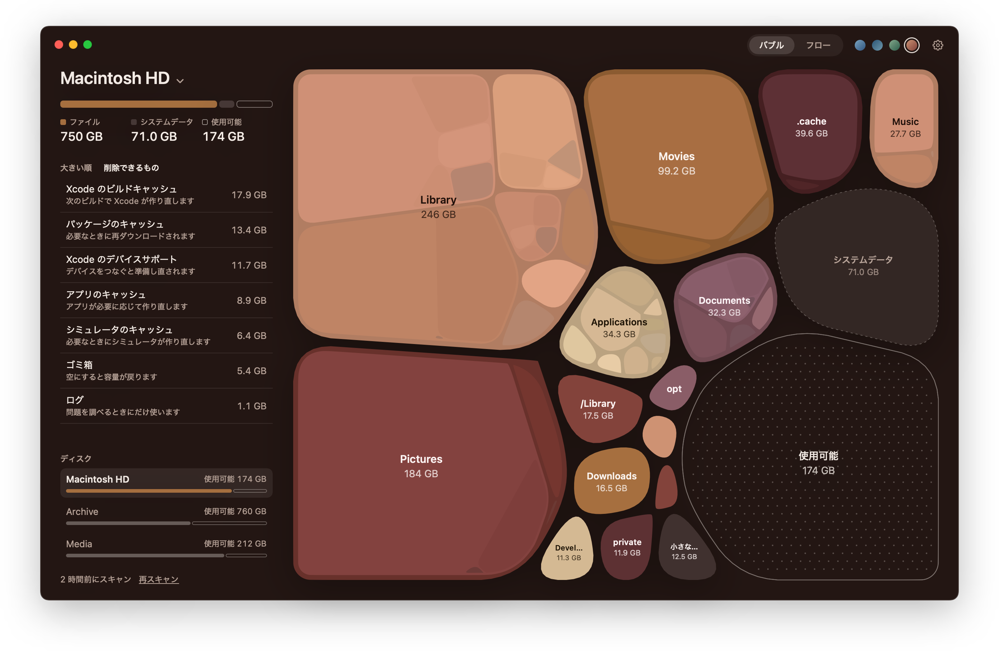

<p align="center">
  
</p>

<h1 align="center">Strata</h1>

<p align="center">
  Mac のディスクを一枚の地図に。空き容量づくりも安心して。
</p>

<p align="center">
  <a href="README.md">English</a> · <a href="README.zh-Hans.md">简体中文</a> · <b>日本語</b>
</p>

<p align="center">
  
</p>

Strata はディスク全体を一枚の図として描きます。フォルダはそれぞれ使っている容量に応じた大きさのバブルになり、中のフォルダが三階層まで入れ子で並びます。空き容量も図の中に場所を持っているので、ディスクがどれだけ埋まっていて、容量がどこに使われているのかがひと目でわかります。

## 二つの見方

<table>
  <tr>
    <td width="50%"></td>
    <td width="50%"></td>
  </tr>
  <tr>
    <td valign="top"><b>フロー</b>はディスクを一階層ずつ横に並べ、各フォルダをその中身と帯でつなぎます。深い階層も上から下へ読み進められます。</td>
    <td valign="top"><b>バブルをクリック</b>すると、その中へズームします。Esc キーか左上の戻るボタンで一つ上に戻ります。</td>
  </tr>
</table>

## 安心して空き容量をつくる

<p align="center">
  
</p>

「削除できるもの」には、必要になれば macOS や開発ツールが自分で作り直すものが並びます。Xcode のビルドキャッシュとデバイスサポート、シミュレータのキャッシュ、Homebrew・npm・pip・Cargo などのパッケージキャッシュ、アプリのキャッシュ、ログ、そしてゴミ箱です。クリックひとつでまとめてゴミ箱に入れられます。図の上のほかの項目も、確認のうえ右クリックメニューからゴミ箱に入れられます。

## 細部まで

- **速い。** ファイルとフォルダが 700 万あるディスクでも、最近の Mac なら約 30 秒。スキャンしている間にも図が育っていきます。結果は保存されるので、次に開くとすぐに表示され、裏で新しくなります。
- **どのディスクでも、フォルダだけでも。** ウインドウ上部のディスク名からディスクを切り替えられます。一つのフォルダだけをスキャンすることもできます。
- **信頼できる数字。** ファイルが実際にディスク上で使っている容量を数えます。ハードリンクと APFS のクローンは一度だけ。ローカルスナップショットやシステムボリュームなど、スキャンで読めない部分は「システムデータ」として表示され、消えてしまうことはありません。
- **四つのカラーテーマ。** 深海、霜、苔、夕暮れ。どれも一つの色の系統だけでまとめています。
- **日本語、English、简体中文。** システムの言語に合わせて表示され、設定でほかの言語も選べます。

## プライバシー

Strata が読むのはファイルの名前とサイズだけです。ファイルを開くことも、インターネットに接続することもありません。起動ディスク全体を見るには「システム設定 › プライバシーとセキュリティ」で「フルディスクアクセス」をオンにする必要があり、最初に開いたときにアプリが案内します。

## インストール

macOS 15 Sequoia 以降が必要です。

[Releases](https://github.com/Glimmer-X/Strata/releases) からダウンロードするか、Xcode 16 以降でソースからビルドします。

```bash
git clone https://github.com/Glimmer-X/Strata.git
cd Strata
scripts/build-app.sh --install --open
```

### Strata が Mac に保存するもの

| 内容 | 場所 |
|---|---|
| スキャン結果（ディスクやフォルダごとに一つ、最大六つ） | `~/Library/Application Support/Strata/` |
| 設定 | 環境設定 `com.glimmer.strata` |

`scripts/uninstall.sh` を実行すると、アプリと一緒にこの二つも削除されます。

## 開発

| スクリプト | 内容 |
|---|---|
| `scripts/build.sh` | すべてをリリース構成でビルド |
| `scripts/test.sh` | ユニットテストを実行 |
| `scripts/build-app.sh [--install] [--open]` | Strata.app をパッケージ化。`--install` でアプリケーションフォルダにコピー |
| `scripts/snapshot.sh OUT.png [オプション]` | ウインドウを表示せずに画面を画像に書き出す。オプションはスクリプト冒頭を参照 |
| `scripts/screenshots.sh` | 架空のディスクを使い、言語ごとにこの README の画像を書き出す |
| `scripts/strings.sh` | 新しい画面の文字列を `Resources/Localizable.xcstrings` に追加 |
| `scripts/release.sh` | リリース版をビルド・公証して zip にまとめる。`local.env` に notarytool のプロファイル名が必要 |
| `scripts/clean.sh` | ビルドで作られたものをすべて削除 |

ビルド成果物やキャッシュ、一時ファイルは、プロジェクト内の `.build/` と `build/` に収まります。

```
Sources/
  ScanCore/    ボリュームのスキャンと結果の保持。UI なし
  MapLayout/   バブル表示とフロー表示のジオメトリ。純粋関数
  Strata/      アプリ本体：状態、テーマ、シーン、描画、画面
Tests/         三つのモジュールのユニットテスト
Resources/     Info.plist、アイコン、文字列カタログ
```

## ライセンス

[MIT](LICENSE)
