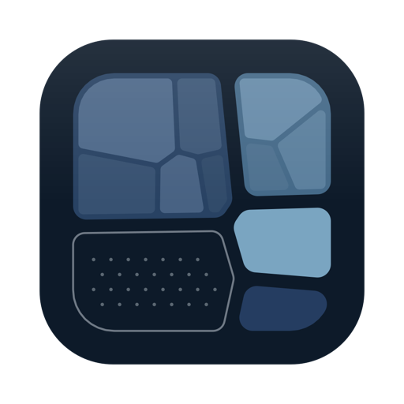
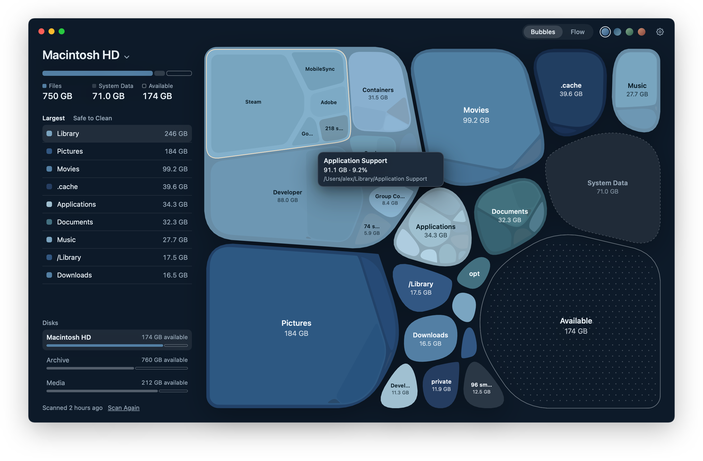
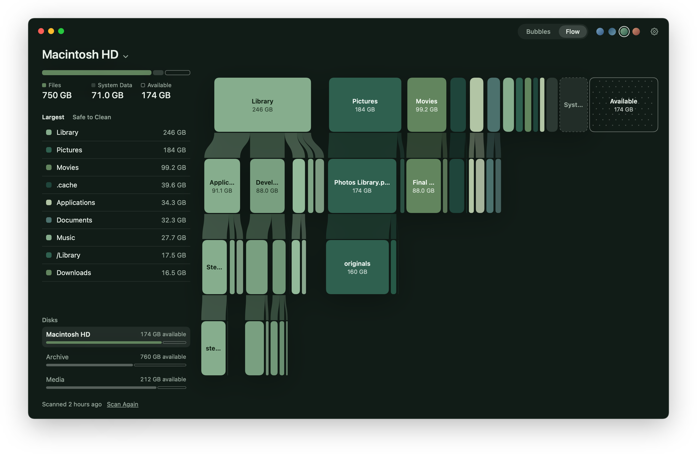
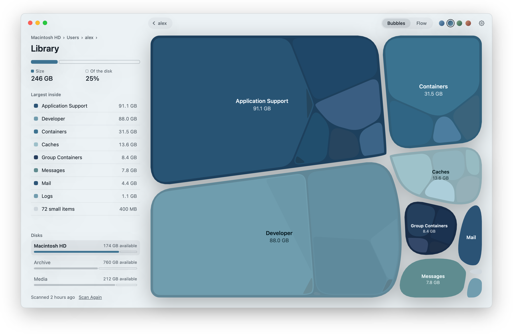
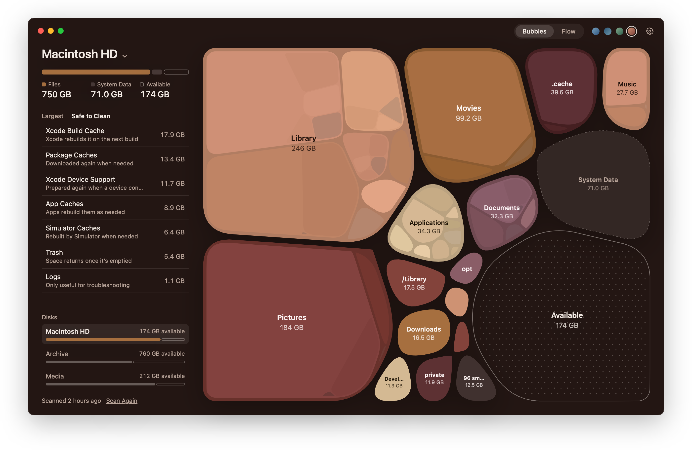

<p align="center">
  
</p>

<h1 align="center">Strata</h1>

<p align="center">
  Visualize your Mac’s disk space, and make room safely.
</p>

<p align="center">
  <b>English</b> · <a href="README.zh-Hans.md">简体中文</a> · <a href="README.ja.md">日本語</a>
</p>

<p align="center">
  
</p>

Strata draws a whole disk as one picture. Each folder is a bubble sized by the space it uses, with the folders inside it nested within, three levels deep. Free space has its place in the picture too, so how full the disk is and where the space went are clear at a glance.

## Two ways to look

<table>
  <tr>
    <td width="50%"></td>
    <td width="50%"></td>
  </tr>
  <tr>
    <td valign="top"><b>Flow</b> lays the disk out row by row, each folder joined to what it holds, so a deep path reads from top to bottom.</td>
    <td valign="top"><b>Click a bubble</b> to go inside. The map zooms into it, and Esc or the back button takes you out again.</td>
  </tr>
</table>

## Make room safely

<p align="center">
  
</p>

Safe to Clean gathers what macOS and your tools rebuild by themselves when they need it. That covers Xcode build caches and device support files, simulator caches, package caches from Homebrew, npm, pip, Cargo and others, app caches, logs, and the Trash. One click moves a group to the Trash. Anything else on the map can go to the Trash from its context menu, after a confirmation.

## Details

- **Fast.** A disk with seven million files and folders takes about half a minute on a recent Mac, and the map grows while the scan runs. Results are kept, so the next launch opens straight away and refreshes in the background.
- **Any disk or folder.** Switch disks from the name at the top of the window, or scan a single folder.
- **Sizes you can trust.** Strata counts the space files really use on disk. Hard links and APFS clones count once, and space the scan can’t reach, such as local snapshots and the system volume, appears as System Data rather than going missing.
- **Four colour themes.** Abyss, Frost, Moss and Dusk, each built from a single family of colours.
- **English, Simplified Chinese and Japanese.** Strata follows the system language, and Settings lets you choose another.

## Privacy

Strata reads file names and sizes. It never opens a file and never connects to the internet. To see the whole startup disk it needs Full Disk Access, which you turn on in System Settings › Privacy & Security; the app points you there on first launch.

## Install

Strata needs macOS 15 Sequoia or later.

Download it from [Releases](https://github.com/Glimmer-X/Strata/releases), or build it from source with Xcode 16 or later:

```bash
git clone https://github.com/Glimmer-X/Strata.git
cd Strata
scripts/build-app.sh --install --open
```

### What Strata keeps on your Mac

| What | Where |
|---|---|
| Saved scans, one per disk or folder, at most six | `~/Library/Application Support/Strata/` |
| Settings | the `com.glimmer.strata` preferences |

`scripts/uninstall.sh` removes the app together with both.

## Development

| Script | What it does |
|---|---|
| `scripts/build.sh` | Builds everything in release mode |
| `scripts/test.sh` | Runs the unit tests |
| `scripts/build-app.sh [--install] [--open]` | Packages Strata.app; `--install` copies it to Applications |
| `scripts/snapshot.sh OUT.png [options]` | Renders the window to an image without showing it; options are listed in the script |
| `scripts/screenshots.sh` | Renders the pictures in this README from a made-up disk, in every language |
| `scripts/strings.sh` | Adds new interface strings to `Resources/Localizable.xcstrings` |
| `scripts/release.sh` | Builds, notarizes and zips a release; needs a notarytool profile in `local.env` |
| `scripts/clean.sh` | Removes every build product |

Build products, caches and temporary files stay in `.build/` and `build/` inside the project.

```
Sources/
  ScanCore/    Scanning a volume and holding the result. No UI.
  MapLayout/   Geometry of the bubble and flow views. Pure functions.
  Strata/      The app: state, themes, scenes, drawing and interface.
Tests/         Unit tests for the three modules.
Resources/     Info.plist, the icon and the string catalog.
```

## License

[MIT](LICENSE)

## References

- M. Balzer and O. Deussen. [Voronoi Treemaps](https://graphics.uni-konstanz.de/publikationen/Balzer2005VoronoiTreemaps). IEEE Symposium on Information Visualization, 2005. [doi:10.1109/INFOVIS.2005.40](https://doi.org/10.1109/INFOVIS.2005.40)
- B. Gregg. [Flame Graphs](https://www.brendangregg.com/flamegraphs.html).
