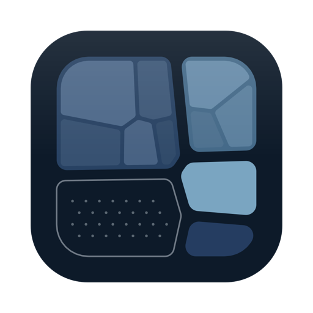
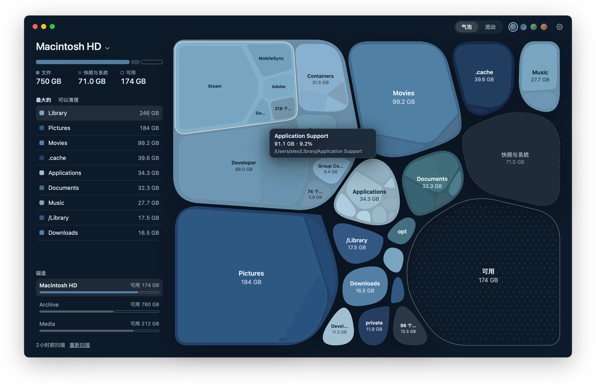
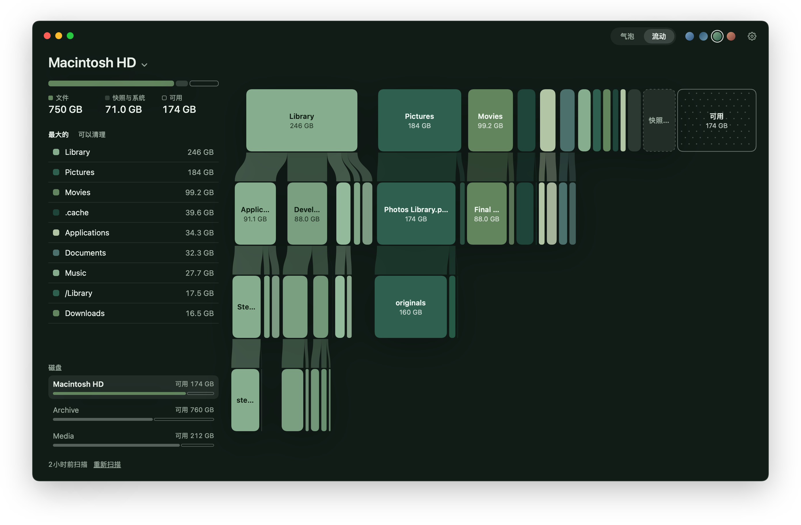
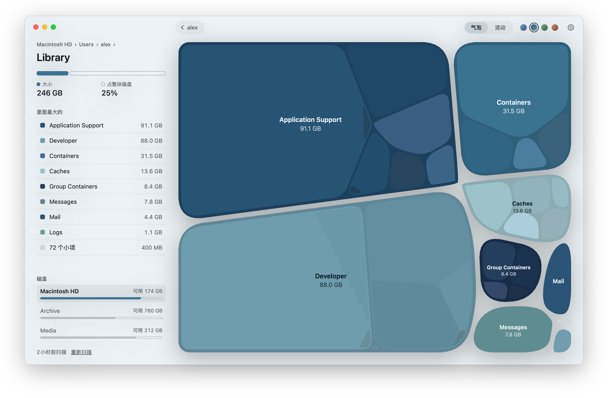
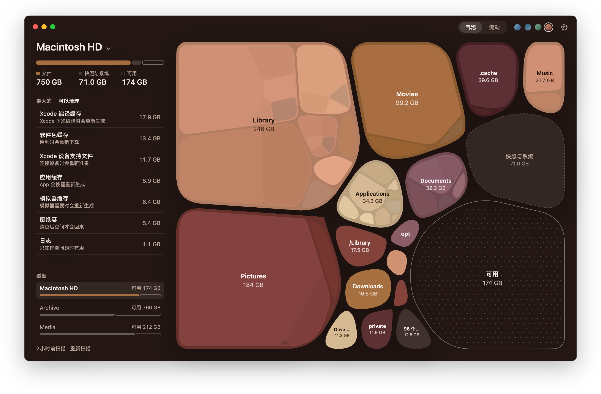

<p align="center">
  
</p>

<h1 align="center">Strata</h1>

<p align="center">
  把 Mac 的磁盘画成一张清楚的图，放心腾出空间。
</p>

<p align="center">
  <a href="README.md">English</a> · <b>简体中文</b> · <a href="README.ja.md">日本語</a>
</p>

<p align="center">
  
</p>

Strata 把整块磁盘画成一张图。每个文件夹是一个气泡，大小就是它占用的空间，里面的文件夹嵌套在其中，一共三层。可用空间也在图里占着自己的位置，磁盘满到什么程度、空间都去了哪里，一眼就能看清。

## 两种看法

<table>
  <tr>
    <td width="50%"></td>
    <td width="50%"></td>
  </tr>
  <tr>
    <td valign="top"><b>流动</b>视图一层一行地排开，每个文件夹用色带连到它里面的东西，再深的路径也能从上往下读下来。</td>
    <td valign="top"><b>点一下气泡</b>就能进去，画面随之推近；按 Esc 或左上角的返回按钮回到上一层。</td>
  </tr>
</table>

## 放心腾空间

<p align="center">
  
</p>

「可以清理」列出的，都是系统和开发工具需要时会自己重新生成的东西，包括 Xcode 编译缓存和设备支持文件、模拟器缓存、Homebrew、npm、pip、Cargo 等软件包缓存、应用缓存、日志，还有废纸篓。点一下，整组移到废纸篓。图上的其他东西也可以从右键菜单移到废纸篓，动手之前都会先确认。

## 细节

- **快。** 一块有七百万个文件和文件夹的磁盘，在近几年的 Mac 上大约半分钟扫完，扫描时图就跟着长出来。结果存在本机，下次打开立刻显示，再在后台悄悄更新。
- **任意磁盘或文件夹。** 点窗口顶部的磁盘名切换磁盘，也可以只扫一个文件夹。
- **数字可信。** 大小按文件在磁盘上实际占用的空间计算，硬链接和 APFS 克隆只算一次。扫描读不到的部分，比如本地快照和系统卷，单独显示为「快照与系统」，不会凭空消失。
- **四套配色。** 深海、霜、苔原、暮色，每套都出自同一个色系。
- **简体中文、English、日本語。** 默认跟随系统语言，也可以在设置里另选。

## 隐私

Strata 只读取文件名和大小，从不打开文件，也从不联网。要看到整块启动磁盘，需要在「系统设置 › 隐私与安全性」里打开「完全磁盘访问权限」，第一次打开时 App 会带你过去。

## 安装

需要 macOS 15 Sequoia 或更新版本。

从 [Releases](https://github.com/Glimmer-X/Strata/releases) 下载，或者用 Xcode 16 及以上版本从源码构建：

```bash
git clone https://github.com/Glimmer-X/Strata.git
cd Strata
scripts/build-app.sh --install --open
```

### Strata 在你的 Mac 上存了什么

| 内容 | 位置 |
|---|---|
| 扫描结果，每个磁盘或文件夹一份，最多六份 | `~/Library/Application Support/Strata/` |
| 设置 | 偏好设置 `com.glimmer.strata` |

`scripts/uninstall.sh` 会把 App 连同这两样一起删掉。

## 开发

| 脚本 | 作用 |
|---|---|
| `scripts/build.sh` | 以 release 方式构建全部目标 |
| `scripts/test.sh` | 运行单元测试 |
| `scripts/build-app.sh [--install] [--open]` | 打包 Strata.app；`--install` 装到「应用程序」 |
| `scripts/snapshot.sh OUT.png [选项]` | 不开窗口，把界面渲染成图片；选项见脚本开头 |
| `scripts/screenshots.sh` | 用虚构的磁盘数据，按每种语言渲染本说明里的图 |
| `scripts/strings.sh` | 把新增的界面文字加进 `Resources/Localizable.xcstrings` |
| `scripts/release.sh` | 构建、公证并打包发布版；需要在 `local.env` 里指定 notarytool 配置 |
| `scripts/clean.sh` | 删除全部构建产物 |

构建产物、缓存和临时文件都留在项目里的 `.build/` 和 `build/`。

```
Sources/
  ScanCore/    扫描磁盘、保存结果，不依赖界面
  MapLayout/   气泡和流动两种视图的几何计算，纯函数
  Strata/      App 本身：状态、配色、场景、绘制和界面
Tests/         三个模块的单元测试
Resources/     Info.plist、图标和多语言文字
```

## 许可

[MIT](LICENSE)
